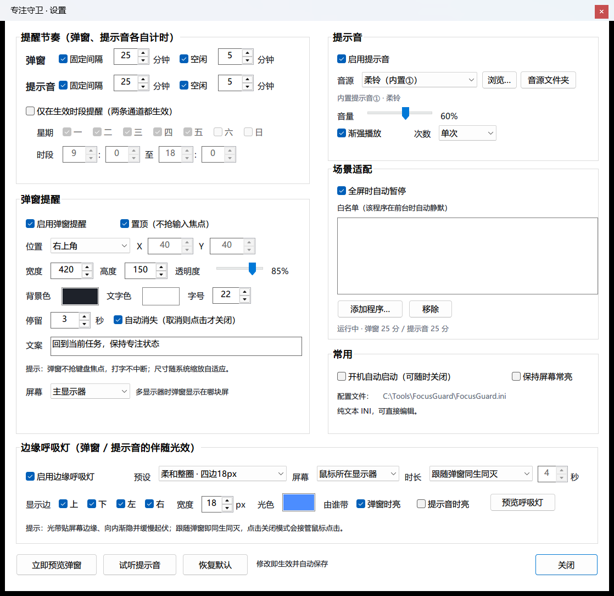
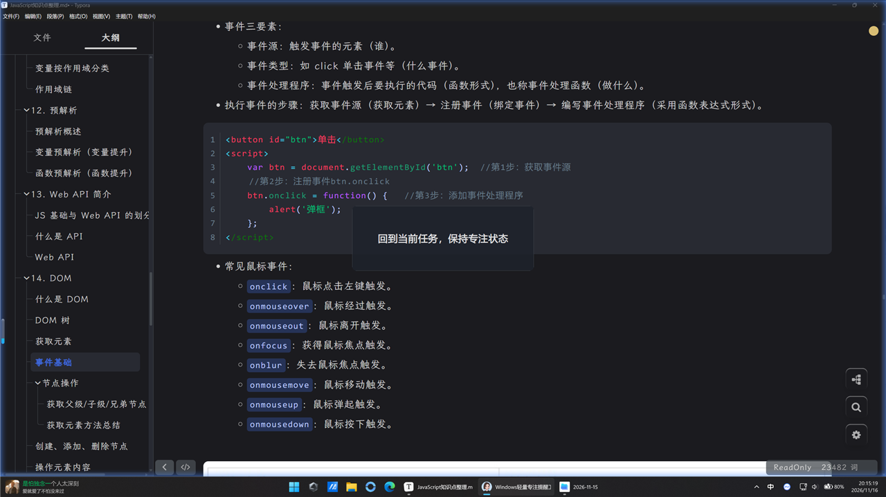
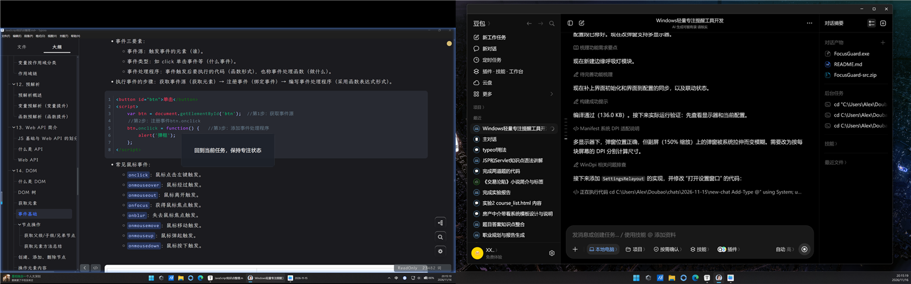
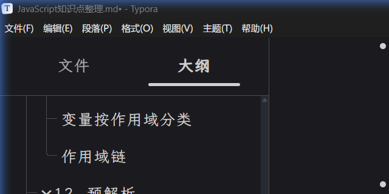

# 专注守卫 FocusGuard

一款 Windows 平台的**极轻量后台专注提醒工具**。设计目标只有一个：在你跑神的那一刻轻轻提醒一次，然后继续安静待在托盘里——不联网、不登录、不上传、不弹广告、不占任务栏。

> **怎么用**：仓库里已带编译好的程序，直接下载 `dist\FocusGuard.exe` 双击即用（旁边 `dist\sounds\` 是用自己的 mp3 时的音源目录，可选）。
> 想自己编译或者改代码，见第 8 节。
>
> **许可**：MIT（见 `LICENSE`）。**平台**：Windows 10 / 11 x64。**体积**：单文件 138.5 KB。

- 单文件绿色程序：`dist\FocusGuard.exe`（138.5 KB / 141,824 字节），双击即用，不需要安装
- 常驻内存（专用工作集）约 **0.2 – 1.1 MB**，工作集（含共享系统 DLL 页）约 **0.7 – 4.0 MB**
- 单线程消息循环（常驻 8 个线程，其余 7 个均由系统 DLL 创建，非本程序逻辑）
- 纯 Win32 / C++，无 .NET、无 Python、无 Qt、无任何第三方库
- **弹窗与提示音的定时完全分开**：两条通道各有自己的「固定间隔 / 空闲检测 / 开关」，
  可以「弹窗每 25 分钟、提示音每 45 分钟」，也可以只留其中一条
- **屏幕边缘呼吸灯**：贴边一条柔和半透明光带，向内渐隐、约 2 秒一个明暗周期；四条边自由选、
  宽度可调、5 套预设、三种时长（跟弹窗 / 固定秒 / 点一下才熄），可单屏也可全屏拼接
- **每块屏各按自己的缩放**：弹窗与光带都按所在显示器 DPI 排版（125% 屏和 150% 屏混插也不会变形、不会跑到别的屏）





*（上面这张：默认预设「柔和整圈」，四条边同时呼吸，中间是同一时刻弹出的提醒弹窗）*

---

## 1. 快速开始

1. 双击 `dist\FocusGuard.exe`。程序**不会**弹出任何窗口，直接驻留到系统托盘（通知区域）。
2. Win11 默认把新图标收进「隐藏的图标」溢出区（任务栏的 `^`），
   点开 `^` 找到蓝色圆盘图标，用鼠标把它拖到任务栏上即为常驻显示。
3. 双击托盘图标 → 打开设置；右键托盘图标 → 七项菜单。

```
右键菜单
├─ 立即提醒一次
├─ 弹窗提醒          ← 勾选=已启用；点一下即整条弹窗通道开/关（立即落盘）
├─ 提示音            ← 勾选=已启用；点一下即整条提示音通道开/关
├─ 保持屏幕常亮      ← 勾选=已启用；只压「显示器休眠 / 系统空闲睡眠」计时器
├─ 暂停提醒  ├─ 暂停 10 分钟
│            ├─ 暂停 30 分钟
│            ├─ 暂停 1 小时
│            ├─ 暂停自定义时长…（1–1440 分钟）
│            └─ 恢复提醒（未暂停时灰色不可点）
├─ 打开设置
└─ 退出程序
```

4. 退出即结束：`退出程序` 会销毁托盘图标与窗口，进程完全退出，不留后台服务、不留驱动、不留计划任务。
   删除 `FocusGuard.exe` 与同目录 `FocusGuard.ini` 即彻底清除（若开过开机自启，先把开关关掉，或删除注册表项
   `HKCU\Software\Microsoft\Windows\CurrentVersion\Run` 下名为 `FocusGuard` 的值）。

`弹窗提醒 / 提示音` 这两个勾选项**每次右键弹出时都按当前配置重建**，勾选状态永远和设置界面一致；
点掉勾选的那一刻：该通道的计时立即清零、不再触发，正在显示的弹窗直接收起、正在播的提示音立刻停止，
设置窗若开着，里面的「启用弹窗提醒 / 启用提示音」也会同步取消勾选并把那一组控件变灰。
两条通道互不影响——所以可以「只留提示音、弹窗全关」或反过来。

弹窗通道开着、提示音被关掉时的托盘菜单：


两条通道都开着：


---

## 2. 功能对照

| 需求 | 实现 |
| --- | --- |
| 固定间隔提醒 1–120 分钟 | ✅ 秒级驱动的定时器，到点触发；**弹窗与提示音各有一套** |
| 空闲检测提醒 1–60 分钟 | ✅ `GetLastInputInfo` 取全局键鼠空闲时长，达阈值触发一次；**两条通道阈值各自独立** |
| 两种模式独立 / 组合 | ✅ 每条通道的「固定间隔」「空闲检测」各自开关，可单用、可叠加 |
| 弹窗与提示音分开控制 | ✅ 弹窗 1 分钟弹、提示音 3 分钟响这类组合完全支持，互不干扰、互不复位 |
| 生效时段（如工作日 9:00–18:00） | ✅ 7 个星期复选框 + 起止时分；时段外自动全静默 |
| 弹窗 5 个预设位置 + 自定义坐标 | ✅ 左上/右上/左下/右下/居中/自定义 X·Y |
| 大小 / 透明度 / 背景色 / 文字色 / 字号 | ✅ 宽 160–1200、高 60–600、不透明度 10–100%、两个取色按钮、字号 12–48 |
| 自定义文案 | ✅ 默认「回到当前任务，保持专注状态」 |
| 自动消失 1–10 秒 或 点击关闭 | ✅ 勾选「自动消失」后按秒计时；取消勾选则必须点击关闭 |
| 置顶 / 非置顶，置顶不抢焦点 | ✅ `WS_EX_NOACTIVATE` + `MA_NOACTIVATE` + `SW_SHOWNOACTIVATE` |
| 内置 2 个提示音 | ✅ ①柔铃 ②深呼吸（程序内合成，不占磁盘） |
| 导入本地 mp3 / wav | ✅ 放进 `dist\sounds\` 文件夹后直接出现在「音源」下拉栏；也可用「浏览…」选任意位置的单个文件 |
| 独立音源文件夹 | ✅ 首次启动自动创建 `sounds\`，「音源文件夹」按钮一键打开；最多列出 48 个音频，按文件名排序 |
| 提示音音量独立、渐强、播放 1/2 次 | ✅ 音量 0–100% 只作用于本程序；渐强为音量包络；次数 1 或 2 |
| 全屏自动暂停 | ✅ 前台窗口覆盖所在显示器即静默 |
| 一键暂停 10/30/60 分钟 + 自定义 | ✅ 托盘子菜单五项 |
| 程序白名单 | ✅ 按前台进程 exe 名匹配（大小写不敏感），列表可增删 |
| 托盘菜单 7 项 / 双击开设置 | ✅ 立即提醒一次、弹窗提醒（勾选=开）、提示音（勾选=开）、**保持屏幕常亮（勾选=开）**、暂停提醒、打开设置、退出程序 |
| 托盘一键开关弹窗 / 提示音 / 常亮 | ✅ 勾选项随配置实时反映；点一下即改配置并落盘，正在显示的弹窗/播放中的音频立刻收掉；常亮项即时调 `SetThreadExecutionState` |
| 保持屏幕常亮（v1.2 新增） | ✅ 设置页「常用」勾选框 + 托盘菜单同名项，两处同一份状态；`keep_awake` 落盘，重开程序按上次状态恢复 |
| 单页设置、无多级菜单 | ✅ 一页五组 + 底部按钮 |
| 配置自动写入本地 | ✅ 任何修改 400ms 去抖后立刻落盘 |
| 开机自启默认关闭、可手动开关 | ✅ 写 `HKCU\...\Run`，值名 `FocusGuard` |
| 屏幕边缘呼吸灯（v1.1 新增） | ✅ 四条边任意组合、宽度 6–80 px、5 套预设 + 自定义、半透明向内渐隐、约 2 秒一次呼吸 |
| 光带由弹窗 / 提示音带 | ✅ 两个复选框可单勾可双勾，双勾时「谁先到谁点灯」 |
| 光带三种时长 | ✅ 跟随弹窗 / 固定 1–10 秒 / 一直呼吸到点击关闭 |
| 光带屏幕范围 | ✅ 鼠标所在显示器 / 所有显示器（拼接成整圈） |
| 弹窗屏幕选择（v1.1 新增） | ✅ 主显示器 / 鼠标所在显示器 / 所有显示器（每屏一个，各按自己的 DPI 排版） |
| 多显示器不同缩放 | ✅ 清单声明 PerMonitorV2，弹窗与光带都按所在屏 DPI 换算尺寸与边距 |

---

## 3. 设置界面

一页到底，六个分组：

- **提醒节奏**：两行分别是「弹窗」和「提示音」，每行各有「固定间隔 X 分钟」与「空闲 X 分钟」两个独立开关；
  下面接「仅在生效时段提醒」（星期 + 起止时间，时段对两条通道同时生效）
- **弹窗提醒**：启用开关、置顶、位置、X/Y（仅「自定义坐标」时可编辑）、宽高、透明度、背景色/文字色/字号、停留秒数、自动消失、文案、
  **屏幕（主显示器 / 鼠标所在显示器 / 所有显示器）**
- **提示音**：启用开关、音源下拉栏（内置①柔铃 / 内置②深呼吸 / `sounds` 文件夹里的音频 / 浏览其他文件…）、
  浏览…、音源文件夹（一键打开存放音频的目录）、音量、渐强播放、次数
- **场景适配**：全屏时自动暂停、白名单列表（添加程序… / 移除）、运行状态提示行
- **边缘呼吸灯**：总开关、预设（5 套 + 自定义）、屏幕（鼠标所在 / 所有）、时长（跟弹窗 / 固定 1–10 秒 / 点一下才熄）、
  四条边复选框、宽度（6–80 px）、光色、由谁带（弹窗时亮 / 提示音时亮，可都勾）、预览呼吸灯
- **常用**：开机自动启动、**保持屏幕常亮**、配置文件路径（中间省略号显示，实际路径见配置文件）

底部：立即预览弹窗 / 试听提示音 / 恢复默认 / 关闭，右侧提示「修改即生效并自动保存」。
**没有任何"保存"按钮**——改完直接关窗也不会丢。

弹窗长这样（默认右上角、85% 不透明、3 秒自动消失、不抢焦点）：


### 边缘呼吸灯是什么样的

它是**贴在屏幕边缘的一条窄带**，颜色由内向外渐隐（贴边最亮、往里淡到 0），靠整体 alpha 做呼吸，
亮度在一个周期里平滑升到峰值再降下来，约 1.8–2.0 秒一轮。五套预设：

| 预设 | 边 | 宽度 | 颜色 | 观感 |
| --- | --- | --- | --- | --- |
| 柔和整圈 | 四边 | 18 px | `#4C8DFF` 蓝 | 最不挑场景，四边同时呼吸 |
| 底边呼吸 | 只有底边 | 26 px | `#2FD3C0` 青 | 像一条水线，视线不下移就注意不到 |
| 左右双栏 | 左 + 右 | 34 px | `#8A6BFF` 紫 | 两侧对称，适合超宽屏 |
| 顶边细线 | 只有顶边 | 10 px | `#E8F0FF` 冷白 | 最克制，只在你抬头时才察觉 |
| 上下暖光 | 上 + 下 | 22 px | `#FF9A5C` 橙 | 暖色，晚上用不刺眼 |

选「自定义」时：四条边各自勾选（可以只留一条边、也可以只留左+下这种组合），宽度 6–80 px、颜色自己挑。
手改边 / 宽度 / 光色，预设会自动落到「自定义」，不会把你改过的东西又按预设覆盖回去。

三种时长（第三个下拉框）：

| 模式 | 行为 |
| --- | --- |
| 跟随弹窗同生同灭 | 弹窗一出现就亮，弹窗消失（自动关或你点掉）的同时熄灭；如果这次只响提示音没弹窗，光带自己亮 3 秒收 |
| 固定 X 秒（1–10） | 亮起后按秒数倒计时，最后 0.5 秒亮度压下去再消失 |
| 一直呼吸，点一下才熄 | 不收超时，只在屏幕上慢慢呼吸，你在任意一条光带边缘点一下（或点任意一条光带）即全部熄灭 |

「由谁带」两个复选框：勾「弹窗时亮」表示弹窗触发就点亮，勾「提示音时亮」表示提示音触发就点亮，两个都勾则谁先到谁点灯。
两个都不勾时程序会自动把「弹窗时亮」勾回来——否则开关打开却永远不会亮，是个死状态。

双屏拼接时的实际观感（左右两块屏各四条边，右屏 150% 缩放所以那条带略宽）：



贴边 1:1 原始像素，能看清向内渐隐的过程（越往里越暗，30 px 左右基本归零）：



### 四个界面问题的修复（v1.2，附根因）

界面现在长这样（125% 主屏、真实截图，组 F 预设下拉里是默认的「柔和整圈 · 四边18px」）：


**① 预设下拉栏文字显示不全（控件里和展开的列表里都截断）**
根因是两件事叠加：`EdgePresetName()` 返回的字符串最长约 20 个字形（≈240 px），而 `cbEPreset` 控件本身只有 150 DIP 宽；
Windows 的 ComboBox **下拉列表宽度默认等于控件宽度**，所以展开后照样截断。
修法是「文案缩短 + 列表加宽」双管齐下：六个预设名统一改成 `主体 · 边+宽度` 的短格式
（`柔和整圈 · 四边18px`、`底边呼吸 · 下26px`、`左右双栏 · 两栏34px`、`顶边细线 · 上10px`、`上下暖光 · 上下22px`、`自定义 · 手动选边`），
控件从 150 加宽到 186 DIP，并逐个发 `CB_SETDROPPEDWIDTH`（预设 206 / 屏幕 140 / 时长 172 / 弹窗屏幕 150 / 音源 300 DIP）——
音源那条 300 DIP 是因为用户爱用长文件名，展开时要能整行看全。

**② 设置页左右留白不一致（左 16 DIP、右 2 DIP）**
根因是布局常数错配，跟 DPI 无关：左列组 A/B 是 `16,*,428,*`（占 16–444），右列组 C/D/E 是 `470,*,408,*`（占 470–878），
而客户区宽 880 → 右边只剩 **2 DIP**；组 F 是 `16,612,862,150`（到 878）同样只余 2。
修法是把右列宽度统一收到 **394**（470–864）、组 F 收到 **848**（16–864），并把组 E 里的
`lbCfgPath` 316→302、提示文字 380→366、`chkAutoStart` 250→244 一并收窄，腾出的位置正好放新的「保持屏幕常亮」。
现在左 16 / 右 16，两侧都是 16 DIP（`probe_dpi.ps1` 实测组 A `x=20 w=535`、组 C `x=588 w=493`，
按 125% 换算即 16…444 与 470…864.8）。

**③ 保持屏幕常亮（新增需求⑤）**
`[general] keep_awake` 一个键 + 设置页一个勾选框 + 托盘菜单一项，三处共用 `g_cfg.keepAwake`。
打开时调 `SetThreadExecutionState(ES_CONTINUOUS|ES_SYSTEM_REQUIRED|ES_DISPLAY_REQUIRED)`，
关闭时调 `SetThreadExecutionState(ES_CONTINUOUS)` 复位；`OnTick()` 里每 20 秒重申一次（静态计数，不额外开线程），
防止别的程序动过执行状态后失效；启动时按 `keep_awake` 恢复上次状态，退出（`WM_DESTROY`）时无条件复位。
只压「显示器休眠」和「系统空闲睡眠」计时器，不阻止正常关机/休眠，也不需要管理员权限。

**④ 拖到另一块屏后字与按钮整体错位**
这是**两个 bug 叠在一起**，单独修任何一个都还会看出来：

- 字体没跟着 DPI 换。`SettingsInit()` 里字体创建被 `if (!s_font)` 挡住，而 `WM_DPICHANGED` 只改了 `g_dpi/g_scale` 并重排控件，
  **字体仍是旧 DPI 的**——150% 屏上控件放大了 1.5 倍、字没放大，视觉上就是"字小、挤在框里"。
  修法：新增 `DropFonts()`，把 `SettingsRelayout()` 改成带参数 `SettingsRelayout(HWND, BOOL rebuildFonts)`，
  DPI 变化时先销毁全部子控件（字体还被窗口引用着不能直接删）→ `DropFonts()` → `SettingsInit()` 按新 DPI 重造字体 → 重建整页。
- 客户区尺寸算不准。原来 `SettingsRelayout()` 结尾用 `AdjustWindowRectEx` 公式直接定窗口尺寸，
  而这个 API 是按**线程 DPI** 算边框的，PerMonitorV2 窗口在别的屏上实际边框厚度与公式不符（DWM 还有一圈不可见边框）——
  实测 150% 屏上客户区只有 `1316×1236`（应为 `1320×1245`），差的这几像素正好让右边距被啃掉。
  修法：新增 `FitWindowToClient()`，不再相信公式，改成"实测 `GetClientRect` → 差多少给窗口补多少"，最多迭代 3 次（实际 2 次收敛）。
- 另外 `WM_DPICHANGED` 的顺序也反过来改对了：**先** `SetWindowPos` 到系统建议的矩形，**再**按新 DPI 重排；
  原来先重排再挪窗，重排算出来的尺寸会被建议矩形覆盖掉，字就再次跟控件错位。

---

## 4. 配置文件

路径规则：优先 `FocusGuard.exe` **同目录**的 `FocusGuard.ini`；若该目录不可写（例如放在只读盘），
自动退到 `%APPDATA%\FocusGuard\FocusGuard.ini`。UTF-8 无 BOM 纯文本，可直接用记事本编辑，
程序启动时读取，任何范围外的值都会被钳制到合法区间。

```ini
; 提醒节奏分成两条独立通道：p_* 属弹窗，s_* 属提示音
[schedule]
sched_on=0           ; 1 = 仅在生效时段提醒
start_h=9            ; 0–23
start_m=0            ; 0–59
end_h=18
end_m=0
days=0111110         ; 7 位、周日在最左，1 生效；0111110 = 周一至五

[popup]
popup_on=1
p_iv_on=1            ; 弹窗：固定间隔开关
p_iv_min=25          ; 弹窗：1–120 分钟
p_idle_on=1          ; 弹窗：空闲检测开关
p_idle_min=5         ; 弹窗：1–60 分钟
pos=1                ; 0 左上 1 右上 2 左下 3 右下 4 居中 5 自定义
x=40                 ; pos=5 时生效，负值允许（多屏）
y=40
w=420                ; 160–1200（96 DPI 基准单位）
h=150                ; 60–600
opacity=85           ; 10–100
bg=1E222A            ; RRGGBB
fg=FFFFFF
font=22              ; 12–48
text=回到当前任务，保持专注状态
autoclose=1          ; 1 自动消失 / 0 点击才关闭
duration=3           ; 1–10 秒
topmost=1
p_mon=0              ; 弹窗显示在哪块屏：0 主显示器 1 鼠标所在显示器 2 所有显示器

[sound]
sound_on=1
s_iv_on=1            ; 提示音：固定间隔开关
s_iv_min=25          ; 提示音：1–120 分钟（可以和弹窗设成不同的值）
s_idle_on=1          ; 提示音：空闲检测开关
s_idle_min=5         ; 提示音：1–60 分钟
src=0                ; 0 内置① 1 内置② 2 本地文件
file=                ; src=2 时的绝对路径（一般在下面说的 sounds 文件夹里）
volume=60            ; 0–100
fade=1               ; 渐强
repeat=1             ; 1 或 2

[edge]               ; 屏幕边缘呼吸灯（下面所有 px 都是 96 DPI 基准单位，运行时按所在屏缩放）
e_on=1               ; 总开关
e_sides=15           ; 边按位组合：1 上 + 2 下 + 4 左 + 8 右；15 = 四边全亮
e_thick=18           ; 光带宽度 6–80
e_preset=0           ; 0 柔和整圈 1 底边呼吸 2 左右双栏 3 顶边细线 4 上下暖光 5 自定义
e_color=4C8DFF       ; RRGGBB
e_by_popup=1         ; 弹窗触发时点亮
e_by_sound=0         ; 提示音触发时点亮（两个都 0 时会被强制回 1）
e_mode=0             ; 0 跟随弹窗 1 固定秒数 2 一直呼吸到点击关闭
e_secs=4             ; e_mode=1 时的秒数，1–10
e_mon=0              ; 0 鼠标所在显示器 1 所有显示器

[scene]
fullscreen_on=1      ; 全屏自动静默

[whitelist]
count=0              ; 下列 item 条数
;item=Code.exe      ; 每行一个 exe 文件名

[general]
autostart=0          ; 开机自启（程序界面里改会直接同步注册表）
keep_awake=0         ; 保持屏幕常亮（0 关 1 开；设置页「常用」与托盘菜单共用这一个键）
```

> 旧版配置里的 `[reminder]` 段（`interval_on / interval_min / idle_on / idle_min`）已被两条独立节奏取代。
> 首次用新版本启动时，如果新键缺失，会自动把旧值继承给**两条通道**，然后按新格式写回，不需要手动改。

**音源文件夹**：`dist\sounds\`（与 `FocusGuard.ini` 同目录，程序目录不可写时随 ini 一起退到 `%APPDATA%\FocusGuard\sounds\`）。
把 mp3 / wav 丢进去，设置界面「音源」下拉栏会自动列出它们（最多 48 个、按文件名排序）；
选中的文件路径写进 `[sound] file=`。文件被删掉时会自动退回内置音，不会报错也不会停止提醒。

---

## 5. 实现要点（为什么能小到这个程度）

- **纯 Win32 + 单线程**：一个隐藏的消息窗口承担托盘回调、定时器与全部状态机，没有任何工作线程、没有消息泵以外的循环。
- **1 秒心跳**：`SetTimer(1000ms)` 里做四件事——暂停是否到期、弹窗倒计时、静默判定（全屏/白名单/时段）、两条通道各自是否该触发。
- **两条独立计时通道**：弹窗与提示音各持有 `nextAt`（下一次间隔到点）和 `idleArmed`（本次空闲是否已触发）。
  一条通道命中只复位它自己的 `nextAt`，不会推迟另一条；空闲阈值也各比各的，所以「弹窗每 25 分钟、提示音每 45 分钟」这种组合能同时成立。
- **音源文件夹即点即用**：`sounds\` 与 `FocusGuard.ini` 同目录（程序目录不可写时随 ini 一起退到 `%APPDATA%\FocusGuard\sounds`），
  打开设置窗时用 `FindFirstFileW` 扫一遍并塞进下拉栏，不建索引、不监听目录；从文件夹拖完文件回到设置窗（`WM_ACTIVATE`）会自动重扫。
- **托盘菜单每次重建**：`ShowTrayMenu()` 里现建现用——按 `g_cfg.popupEnabled / soundEnabled` 决定两项是否带 `MF_CHECKED`，
  `TrackPopupMenu(TPM_RETURNCMD)` 取回命令号后统一交给 `ToggleChannel()`：改配置 → 落盘 → 复位该通道计时 →
  （关掉时）收起在显示的弹窗、停掉在播的音频 → 同步已打开的设置窗 → 刷新托盘气泡文案。
  这样勾选提示、设置界面、`ini` 三处永远是同一份状态，没有第二份缓存要同步。
- **音频不建线程**：内置音与 WAV 走 `waveOut` 单缓冲异步播放，音量/渐强/重复次数/重复间隔在播放前**预烘焙进 PCM 缓冲**，播完即释放——不需要回调线程，也不动系统音量。MP3 走系统 MCI（`mpegvideo` 设备），渐强用 100ms 定时器阶梯升音量；`TIMER_AUDIO` 只在播放期间存在，闲时立刻 Kill。
- **弹窗零焦点**：`WS_EX_LAYERED | WS_EX_TOOLWINDOW | WS_EX_NOACTIVATE`，`WM_MOUSEACTIVATE` 返回 `MA_NOACTIVATE`，`SW_SHOWNOACTIVATE` 显示 → 窗口置顶但不抢键盘，打字不中断；圆角用 `CreateRoundRectRgn` + `SetLayeredWindowAttributes`。
- **空闲时主动收缩工作集**：启动 3 秒后、每次弹窗消失后、**每次关掉设置窗后**（立即一次 + 1.5 秒后补一次）、
  **每次托盘菜单收起后**都调用 `SetProcessWorkingSetSize(-1,-1)`，把不用的页面还给系统。
  托盘菜单这一条是实测补上的：弹出一次菜单会把 comctl32 / 主题 / 菜单窗口一并拉进进程
  （本机 +4.3 MB、+171 句柄、+8 线程），菜单一收起就 trim，常驻值立刻回到 0.44 MB 一档。
- **公共控件延迟加载**：`InitCommonControlsEx` 只在打开设置窗时调用，常驻期不把 comctl32 及其依赖拉进进程（线程数从 18 降到 8）。
- **全屏判定**：取前台窗口矩形，与所在显示器 `rcMonitor` 比对（±1px 容差），并排除桌面/任务栏等系统窗口，避免把桌面当全屏。
- **白名单缓存**：按窗口句柄缓存取到的 exe 名，避免每秒 `OpenProcess` 的额外开销。
- **配置自己解析**：不依赖 `WritePrivateProfileString`（它会走 ANSI 代码页，中文可能乱码），自己写了几十行的 UTF-8 INI 读写。
- **光带是"一条边一个分层窄窗"**：每条边一个 `WS_EX_LAYERED | TOOLWINDOW | NOACTIVATE | TOPMOST` 的窗口，
  32bpp DIB 上先把「贴边 alpha 255 → 内侧 0」的二次衰减渐变**预乘 alpha 画进 BGRA**，然后每次呼吸只改
  `UpdateLayeredWindow` 的 `SourceConstantAlpha`——预乘过的位图配合一个整数 alpha，
  DWM 自己就能做出平滑的明暗过渡，程序这边一帧只调 8 个整型值，不做重绘、不占额外内存。
- **呼吸曲线**：50 ms 一拍、周期 2000 ms，用平滑三角波 `x²(3−2x)` 而不是正弦——省掉浮点三角函数，
  波形两端导数也是 0，肉眼上完全没有顿挫。峰值 alpha 120（约 47% 不透明），所以是「余光能看见、盯着不刺眼」。
- **光带不抢鼠标**：只有「一直呼吸到点击关闭」模式才去掉 `WS_EX_TRANSPARENT` 亲自接收 `WM_LBUTTONUP`（点一下就全灭），
  其余模式一律点穿——你在屏幕边缘拖选文件、拖滚动条，光带完全不挡。
- **每块屏按自己的 DPI 建窗**：先按系统缩放粗建窗口并 `ShowWindow` 挪到目标屏，再 `GetDpiForWindow` 取该屏真实 DPI、
  `MulDiv(宽度, dpi, 96)` 重算真实厚度与矩形，最后 `UpdateLayeredWindow` 一次性把位置和尺寸都定下来——
  这样 125% 屏上是 23 px、150% 屏上是 27 px，两条光带在接缝处的视觉宽度一致。
- **弹窗也开始按屏排版了**：`CollectSlots()` 先在每块目标屏上算出一个槽位（工作区、边距、九宫格/居中的落点），
  `PlaceSlot()` 用**该屏 DPI 的 24 px 边距**换算，然后逐屏走一遍「粗定位 → 取该屏 DPI → 按 DPI 重算宽高与字号 →
  `SetWindowPos` 定稿」。字体按 DPI 缓存成 `HFONT`，`WM_PAINT` 里按窗口自己的 DPI 取字号和 `MultDiv` 内边距，
  所以 150% 副屏上的弹窗是 630×225、字号 33，125% 主屏上是 525×188、字号 27.5→27，两边都不糊、不挤。
- **"所有显示器"统一取工作区**：`EnumDisplayMonitors` 的回调里用 `GetMonitorInfoW` 的 `rcWork`，
  与「鼠标所在显示器」一路口径，光带不会压在任务栏上；弹窗的九宫格也用工作区，居中时视觉重心在可用区正中。
- **清单声明 PerMonitorV2**：`app.manifest` 里 `dpiAware true` + `dpiAwareness PerMonitorV2, PerMonitor`，
  进程内 `GetProcessDpiAwareness` 实测为 2；启动时的 `g_dpi` 优先用 `GetDpiForSystem()`，取不到才回退老接口。
- **设置窗整窗重建**：窗口尺寸依赖 DPI，而 DPI 又可能因为拖到另一块屏而变，所以控件不在 `WM_CREATE` 里建，
  而是 `SettingsOpen()` 里「建窗 → `SyncScaleForWindow` 校正缩放 → `SettingsRelayout(h, TRUE)` 布局并填值」；
  `WM_DPICHANGED` 时**先**按建议矩形挪窗、**再**更新 `g_dpi/g_scale` 并整页重建（连字体一起按新 DPI 重造），控件不会错位。
- **尺寸不信公式，信实测**：`FitWindowToClient(h, S(880), S(830))` 用「当前 `GetClientRect` → 与目标差多少就给窗口补多少」迭代收敛。
  `AdjustWindowRectEx` 是按线程 DPI 算非客户区的，PerMonitorV2 窗口在别的屏上（尤其叠加 DWM 的不可见边框）会对不上，
  实测 150% 屏上会差 4×9 像素；改成实测收敛后，125% 与 150% 两屏的客户区都精确等于 `S(880)×S(830)`。
- **字体跟着 DPI 换**：三套 `HFONT` 由 `SettingsInit()` 统一创建、`DropFonts()` 统一销毁；DPI 变化时按"先销毁子控件、
  再删字体、再重造字体、最后重建整页"的顺序走——顺序反了会删到还被窗口引用的字体对象。
- **下拉列表按需加宽**：ComboBox 展开时默认不许比控件宽，所以每个可能放长文本的下拉都发一次 `CB_SETDROPPEDWIDTH`
  （预设 206 / 时长 172 / 屏幕 140 / 弹窗屏幕 150 / 音源 300 DIP），长文件名与长预设名都能整行显示。
- **左右留白按 16 / 16 对称**：所有分组框的右边界统一落在 864（客户区 880 − 16），左列 `16,*,428,*` 保持不动，
  右列 408 → 394、组 F 862 → 848，底部「关闭」按钮右边同样停在 864。
- **保持屏幕常亮只借系统的一个执行状态位**：`SetThreadExecutionState(ES_CONTINUOUS|ES_SYSTEM_REQUIRED|ES_DISPLAY_REQUIRED)`
  是一次调用就长期生效的线程级标记，`OnTick()` 每 20 秒重申一次（一个静态计数，不建线程、不建定时器），
  关闭时 `SetThreadExecutionState(ES_CONTINUOUS)` 复位；`WM_DESTROY` 里再无条件复位一次，保证退出无残留。
  （本机的 `powercfg /requests` 需要管理员权限，普通权限下的等价取证见「验证记录」里对返回值 `0x80000003` 的实测。）

---

## 6. 实测数据（本机：2560×1440 @125%，双显示器）

| 指标 | 实测 |
| --- | --- |
| exe 体积 | 141,824 字节（138.5 KB） |
| 专用工作集（任务管理器「内存」列） | 全新启动静置 0.20 MB；开过一次托盘菜单（收起后）0.44 MB；开过一次设置窗（关闭后）0.44–0.57 MB；一条光带亮起期间 1.08 MB |
| 工作集（含共享 DLL 页） | 0.69 MB（刚启动）→ 1.33 MB（开过菜单/设置窗之后）～ 3.97 MB（光带亮起时） |
| 开过一次设置窗并关闭后 | 专用 0.43–0.44 MB / 工作集 1.37–1.38 MB，16 线程 / 329 句柄 |
| 设置窗打开期间（峰值） | 专用 5.26 MB / 工作集 27.84 MB（公共控件 + 主题 + 字体，正常且可回收） |
| 光带创建瞬间（瞬时峰值） | 专用 5.0–5.6 MB / 工作集 20.5–21.0 MB，1 秒内回落到 1.1 MB / 4.0 MB |
| 双屏 8 条光带（150% 屏也一起亮） | 专用 2.4–2.6 MB（瞬时峰值 4.6–6.5 MB）/ 工作集 6.7 MB（瞬时 15.5–24.7 MB），熄灭后回落 |
| 线程数 | 常数 8（1 个 UI 线程 + 系统 DLL 自带线程）；开过菜单/设置窗后 16（comctl32/主题线程常驻） |
| 句柄数 | 未开菜单/设置窗 161；开过之后稳定在 329–332，反复开关不再增长；光带亮起峰值 ≈495，熄灭后回落 |
| 常驻 CPU | 空闲 60 秒累计 ≈0.25 秒（每秒一次 1ms 级心跳）；光带呼吸期间 50 ms 一拍，仍只占个位数百分比 |
| 设置窗客户区（同一份代码拖到两块屏） | 125% 屏 `1100×1038`；150% 屏 `1320×1245`；双向往返后回到 `1100×1038`，控件越界数 0 |
| 配置文件 | 1011 字节（含两条通道节奏 + 音源路径 + `[edge]` 段 + `keep_awake`） |

进程名 `FocusGuard.exe`，可在任务管理器「详细信息 → 内存（专用工作集）」里直接核对。

---

## 7. 已知边界

1. **MP3 播放依赖系统解码器**：走 MCI，Win10/11 自带 mp3 解码器可用；播放期间内存会短暂上升，播完回落。内置音与 WAV 不走这条路径。
2. **渐强对内置音/WAV 是"预烘焙"**：一次算好包络再播放，所以严格按采样渲染；MP3 无法逐样本处理，用 100ms 阶梯升系统外的独立音量（部分解码器不支持 `setaudio volume` 时会退化为按系统音量原样播放）。
3. **全屏判定是"前台窗口覆盖整块显示器"**：无边框最大化窗口会被视为全屏；分屏（窗口只占半屏）不算，正是想要的行为。
4. **白名单按 exe 文件名匹配**，大小写不敏感，例如 `Code.exe`；不按完整路径，便于程序更新后仍生效。
5. **多显示器不同缩放**：弹窗与光带都按所在显示器 DPI 换算尺寸和边距（清单已声明 PerMonitorV2），
   同一块屏内是像素级准确的；跨 DPI 屏拖动设置窗会触发重排，不会错位。
   但「自定义坐标」（`pos=5`）仍然是绝对物理坐标，只会在主屏上放一个窗口——这是刻意的，
   因为自定义坐标的语义就是"我说了算的那一个点"。
6. **光带的呼吸是 alpha 呼吸，不是颜色呼吸**：峰值约 47% 不透明，如果你把光带宽度调到 80 px 会觉得偏亮，
   调回 18–26 px 最接近"余光可察觉"的程度；深色壁纸下最明显，纯白背景上会更淡（这正是它不刺眼的原因）。
7. **「一直呼吸到点击关闭」模式会接管边缘一小条区域的鼠标**：只有这个模式下光带才不点穿，
   点任意一条光带即全部熄灭；其他两种模式完全点穿，不挡任何操作。
8. **光带遵守与弹窗同源的静默规则**：全屏、白名单程序在前台、非生效时段、手动暂停期间都不点亮；
   「立即提醒一次」也遵守通道开关——只开提示音时触发的光带，不会有弹窗跟着出现。
9. **空闲检测触发后需要重新有操作**：每条通道各自维护"本次空闲已触发"标记，弹窗通道触发后不会每秒钟连续弹，
   必须等你重新动键鼠（空闲计时归零）后才重新生效；两条通道的这个标记互相独立。
10. **静默期不补偿**：全屏、白名单、非生效时段、手动暂停这四种静默期间，到点该响的提醒不会在恢复后补发，恢复后重新开始计时。
11. **Win11 托盘溢出区**：新图标默认收进 `^`，需要手动拖出一次，之后常驻。
12. **开机自启**写入当前用户注册表 `HKCU\Software\Microsoft\Windows\CurrentVersion\Run`，值名 `FocusGuard`，值为带引号的完整 exe 路径；移动 exe 位置后需要重开一次开关。
13. **光带创建瞬间的峰值不是常驻值**：第一次亮起时会看到专用工作集瞬间到 5 MB 左右、工作集到 21 MB，
   那是 DIB 与 DWM 合成页的首次分配；1 秒内就回落到 1 MB / 4 MB，熄灭后完全释放。常驻值始终在 0.2–0.6 MB 区间。
14. **「保持屏幕常亮」不等于"拔掉睡眠"**：它只重置"显示器休眠"和"系统空闲睡眠"的计时器；手动关机、合盖、主动休眠、
    以及电池极低电量策略照常生效。它也不阻止屏保（屏保是用户设置，不是系统空闲计时器）。
    想自己确认它在生效，需要用**管理员**命令提示符跑 `powercfg /requests`，在 `DISPLAY:` 段下应能看到 `[PROC] FocusGuard.exe`；
    普通权限下这个命令会直接报"需要管理员权限"。
15. **预设名是刻意写短的**（`柔和整圈 · 四边18px` 这种格式）：下拉列表已经加宽到 206 DIP，能整行显示；
    如果你以后自己改 `edge.cpp` 里的名字，记得别超过约 15 个汉字，否则控件折叠状态下（186 DIP）还会截断。
16. **跨 DPI 屏拖窗时，控件会整体重建一次**：屏幕上会看到一帧"闪一下"（销毁旧控件 → 重造字体 → 重建整页），
    这是为了字体跟着 DPI 换而付的最小代价；同一块屏内拖动不会触发任何重建。
17. **开过一次托盘菜单或设置窗后，句柄与线程数不会回落**（161 → 332、8 → 16）：这是 comctl32 与主题 DLL 被加载后的固定成本，
    内存会随着 `AppTrimWorkingSet()` 回落（4.47 MB → 0.44 MB），但已加载的模块不会为了"数字好看"去 `FreeLibrary`——
    强行卸载会让下一次开菜单明显卡一下，得不偿失。

---

## 8. 自行构建

需要 Visual Studio 的「使用 C++ 的桌面开发」工作负载（含 Windows 10/11 SDK）。

```powershell
cd <项目目录>
Set-ExecutionPolicy -Scope Process -ExecutionPolicy Bypass -Force
& .\build.ps1
```

`build.ps1` 会自动定位 vcvarsall/rc.exe、补齐 INCLUDE/LIB、生成 `build\build.bat` 并编译到 `dist\FocusGuard.exe`。
编译命令要点：`/O2 /utf-8 /GS- /MD /DNDEBUG`，链接 `/SUBSYSTEM:WINDOWS /OPT:REF /OPT:ICF /MANIFEST:NO`
（清单由 `src\app.rc` 里的 `RT_MANIFEST` 提供，不让链接器再生成一份导致冲突）。

图标不是现成素材：`tools\make_icon.py` 用纯 Python（无 PIL）程序化生成 `src\app.ico`（7 种尺寸、4× 超采样抗锯齿）。

---

## 9. 文件清单

```
dist\FocusGuard.exe      ← 交付物：绿色单文件程序
dist\FocusGuard.ini      ← 首次运行自动生成的默认配置
dist\sounds\             ← 用户音源文件夹（自动创建）：丢进 mp3/wav 即可在「音源」下拉栏选到
                           附两个示例音（可删）与一份说明.txt
docs\settings.png        ← 设置界面截图（六组，含边缘呼吸灯）
docs\popup.png           ← 提醒弹窗截图
docs\edgeglow.png        ← 边缘呼吸灯 + 弹窗同屏实拍（主屏 50%）
docs\edgeglow-2mon.png   ← 双屏拼接光带全景（含 150% 副屏）
docs\edgeglow-zoom.png   ← 贴边 1:1 原始像素，展示向内渐隐的渐变
docs\traymenu.png        ← 托盘菜单（两条通道都开）
docs\traymenu-mixed.png  ← 托盘菜单（弹窗开、提示音关）
src\app.h                ← 常量与模块声明
src\main.cpp             ← 托盘 / 调度状态机 / 自启 / 自定义暂停框
src\config.cpp           ← UTF-8 INI 读写与范围钳制
src\audio.cpp            ← waveOut 预烘焙 + MCI 双引擎
src\popup.cpp            ← 分层无焦点弹窗（多屏 + 按屏 DPI）
src\edge.cpp             ← 屏幕边缘呼吸灯（分层窄窗 + 预乘渐变 + alpha 呼吸）
src\settings.cpp         ← 单页设置窗（代码直建，非对话框模板；支持 DPI 重排）
src\app.rc / app.manifest / resource.h / app.ico
build.ps1                ← 一键构建
tools\make_icon.py       ← 图标生成器
tools\capture.ps1        ← 窗口截图（PrintWindow，供文档使用）
tools\probe_dpi.ps1      ← 把设置窗拖到指定坐标，导出每个控件相对客户区的坐标并统计越界数
tools\tray_shot.ps1      ← 弹出托盘菜单并截图（含每项勾选态）
tools\tray_click.ps1     ← 在同一脚本里完成"弹菜单 → 悬停第 N 项 → 真实鼠标点击"，用于复验托盘开关
tools\probe_es.c         ← `SetThreadExecutionState` 返回值取证探针（不属于交付物，仅供验证）
docs\verify-125.png      ← 125% 屏修复后的设置窗（取证）
docs\verify-150.png      ← 150% 屏修复后的设置窗（取证）
docs\verify-150-before.png ← 修复前 150% 屏的错位原样（对照）
LICENSE                  ← MIT
build\                   ← 中间产物（.obj / .res / build.bat），已 .gitignore，可删
```

---

## 10. 验证记录

已在真机（Windows 11，2560×1440@125%，双显示器）完成：

- ✅ 编译零错误零警告，产物 119 KB（121,856 字节）→ 加音源文件夹后 122 KB（124,928 字节）→ 加托盘快速开关后 122.5 KB（125,440 字节）→ 加边缘呼吸灯 + 多屏 DPI 后 137.5 KB（140,800 字节）→ 加「保持屏幕常亮」+ v1.2 四项界面修复后 **138.5 KB（141,824 字节）**
- ✅ 启动即静默驻留托盘，任务栏无窗口按钮，Alt+Tab 不可见
- ✅ 托盘图标正常显示（蓝色圆盘）
- ✅ 双击/`--settings` 打开设置窗，五组布局无重叠、无截断，控件联动禁用正确
  （`位置=右上角` 时 X/Y 自动变灰；关闭「自动消失」时停留秒数变灰）
- ✅ `--remind` 触发弹窗：按「右上角」预设定位、圆角、85% 不透明度、白字居中
- ✅ 弹窗时序实测：0.3 s 出现在 (2005, 30)、525×188，3.0 s 仍可见，3.2 s 自动消失（停留设为 3 秒）
- ✅ 弹窗不抢焦点：触发前后前台窗口句柄完全一致（仍是原来的 Chrome 窗口）
- ✅ 弹窗扩展样式确认为 `WS_EX_LAYERED | WS_EX_TOOLWINDOW | WS_EX_TOPMOST | WS_EX_NOACTIVATE`（0x8080088）
- ✅ 修改即存：真实键盘把「停留」从 3 改成 6，约 400 ms 去抖后 `FocusGuard.ini` 里出现 `duration=6`
  （说明：早期用跨进程 `WM_COMMAND`/`WM_TIMER` 模拟的测试得到假阴性，那是测试手法问题——真实键盘输入已验证通过）
- ✅ 开机自启开关往返：勾选后 `HKCU\Software\Microsoft\Windows\CurrentVersion\Run` 出现
  `FocusGuard = "…\dist\FocusGuard.exe"` 且 `autostart=1`；取消后该值被删除、`autostart=0`，
  同一注册表项下的其他自启项（CampusLoginApp、MacTypeTray）未受影响
- ✅ 默认不写自启：全新启动时注册表 Run 下**没有** FocusGuard 值
- ✅ 单实例：第二个实例只唤醒已有进程，不会出现两个托盘图标
- ✅ 配置范围钳制：手改 `duration=12` 被钳到 10
- ✅ 删掉 `FocusGuard.ini` 后启动会立刻重新生成 658 字节的默认配置
- ✅ **托盘快速开关通道（v1.1 新增）**，用真实鼠标在真机上点真菜单验证（菜单通过 `WM_TRAY_MSG / WM_RBUTTONUP`
  弹出，`#32768` 菜单窗口截图取证，再按行高定位点击）：
  - 初始两通道都开 → 菜单两项均带 ✔（`docs\traymenu.png`）；
  - 点「提示音」→ `FocusGuard.ini` 立刻变成 `sound_on=0`（`popup_on` 仍为 1），菜单重开后只有「弹窗提醒」带 ✔
    （`docs\traymenu-mixed.png`）→ 说明两个勾选各自独立、且是按当前配置重建的；
  - 再点「弹窗提醒」→ `popup_on=0`，此时设置窗状态行变为「运行中 · 弹窗与提示音均已停用」，菜单两项都不带 ✔；
  - 依次点回两项 → `popup_on=1 sound_on=1`，状态行恢复「运行中 · 空闲 5 分钟触发」；
  - 设置窗同步：托盘关掉提示音后，`启用提示音` 勾选态读到 0，`音源下拉/音量/渐强/次数` 全部 `IsWindowEnabled=false`（变灰），
    `提示音·固定间隔/空闲` 两行 4 个控件也一并变灰（弹窗那组不受影响）；
  - `立即提醒一次` 也遵守通道开关：某通道关掉后它只触发还开着的那条（`AppTriggerReminder` 里按 `popupEnabled/soundEnabled` 分流）。
- ✅ 常驻实测：私有工作集 0.20 MB / 工作集 0.69 MB / 8 线程 / 161 句柄 / 空闲 CPU 0.05 s
- ✅ **两条通道独立计时（核心验证）**：设「弹窗 1 分钟 / 提示音 3 分钟」（两条的空闲检测都关），
  启动后按 0.4 s 间隔采样 200 秒，记录弹窗可见性与进程句柄/线程数：

  | 时间 | 现象 | 含义 |
  | --- | --- | --- |
  | 60.7 s | 弹窗出现（句柄 161→164），62.4 s 消失 | 弹窗按自己的 1 分钟走 |
  | 120.6 s | 弹窗出现→122.3 s 消失，**句柄无变化** | 到点只弹、没播音 |
  | 180.7 s | 弹窗出现，同时句柄 164→247→257、线程 5→8，184.5 s 回落 | 到点弹窗 + 播音同时发生 |

  结论：弹窗严格按 1 分钟节奏（60/120/180 s 各一次），提示音只在第 3 分钟那次出现——
  一条通道命中不会复位、也不会推迟另一条，两条定时机制确实各走各的。
- ✅ **通道联动变灰实测**：关掉「启用弹窗」→ 弹窗行两个开关与两个输入框全灰，提示音行不受影响；
  关掉「启用提示音」→ 反之；取消弹窗的「空闲」勾选 → 只有弹窗的空闲输入框变灰，间隔仍可编辑。
- ✅ **旧配置迁移实测**：旧文件（`[reminder] interval_on=1 interval_min=3 idle_on=1 idle_min=5`）启动后
  打开并关闭一次设置窗（触发落盘），文件变成新格式：`[reminder]` 段消失，
  `p_iv_on=1 p_iv_min=3 p_idle_on=1 p_idle_min=5`，两条通道都继承到了旧值，其余字段原样保留。
- ✅ 关设置窗后内存回落：私有 0.41 MB / 工作集 1.35 MB / 11 线程 / 307 句柄
- ✅ **音源文件夹（v1.1 新增）**：
  - 首次启动自动创建 `dist\sounds\`，`CfgSoundDir()` 与 ini 同目录解析，目录不存在时就地建；
  - 往文件夹里放 2 个 wav 后打开设置，下拉栏条目数 = **5**（柔铃 / 深呼吸 / 2 个文件夹音频 / 浏览其他文件…）；
  - 选中第 3 项（`示例音1-清铃.wav`）→ `FocusGuard.ini` 立刻写成 `src=2`、`file=…\dist\sounds\示例音1-清铃.wav`；
  - 试听该 wav：句柄 213 → 峰值 287、线程 7 → 8，播完回落 → 确实走的是 `waveOut` 读文件路径，不是内置音兜底；
  - 设置窗开着时往文件夹新增一个文件，再激活设置窗，条目数 **5 → 6**（`WM_ACTIVATE` 里重扫目录）；
  - 「音源文件夹」按钮走 `ShellExecuteW("open", <sounds 目录>)`，同环境单独调用该 API 返回 42（>32 即成功）；
  - 选中的文件删掉后自动退回内置音（`LoadWavMono` 失败即落到内置 PCM 分支），不会中断提醒。

- ✅ **边缘呼吸灯（v1.1 新增，双屏真机逐项取证）**。测试环境：主屏 2560×1440 @125%（工作区 0–1380），
  副屏 2560×1600 @150%（144 DPI，物理 x 2560–5120、y −155–1445，任务栏占 72 px，工作区底边 1373），
  虚拟屏 5120×1600、原点 (0,−155)；进程 `GetProcessDpiAwareness` = 2：

  - **几何正确**（`e_mon=1` 所有显示器，四边全开，宽度 18）：8 条分层窗口，主屏
    `(0,0) 2560×23`、`(0,1357) 2560×23`、`(0,0) 23×1380`、`(2537,0) 23×1380`；副屏
    `(2560,−155) 2560×27`、`(2560,1346) 2560×27`、`(2560,−155) 27×1528`、`(5093,−155) 27×1528`
    —— 125% 屏 18→23 px、150% 屏 18→27 px，竖直方向取工作区高度（避开任务栏）。
  - **渐变符合设计**（5120×1600 全屏抓图的原始像素）：主屏左边 x=1 为 `RGB(33,82,80)` → x=12 `(30,51,52)`
    → x=30 `(27,27,31)`；副屏左边 x=2561 `(24,75,71)`；主屏上边 `(37,90,84)` → 31 px 后 `(31,31,31)`。
    贴边最亮、向内 30 px 归零，二次衰减平滑无带状分层。
  - **呼吸确实是"呼吸"**：对主屏左边 (0,700) 逐帧采样（220 ms 间隔），通道和值
    `85 → 112 → 177 → 238 → 266 → 238 → 177 → 109 → 85 → 105 → 163 → 228`，
    峰值 `RGB(50,80,136)`，周期约 1.8–2.0 s，升降对称、两端平滑——不是硬开关闪烁。
  - **跟随弹窗（`e_mode=0`）**：弹窗 3 秒消失后 `FocusGuard.EdgeGlow` 窗口数归 0；
    `PopupWindow` 仍是 2 个但 `vis=False`（窗口复用不销毁，下次直接改位置显示）。
  - **点一下才熄（`e_mode=2`）**：8 条光带常驻不超时；把光标移到主屏左边缘 (12,400) 左键点一次 → 4 条全部销毁；
    再在副屏左边缘 (2570,700) 点一次 → 8 条全部销毁；两次都没有动到正在显示的弹窗（弹窗仍按自己的 3 秒收）。
  - **固定秒数（`e_mode=1`，`e_secs=4` 与 `10`）**：到点自动销毁，5 秒后窗口数 0。
  - **鼠标所在显示器（`e_mon=0`）**：光标移到副屏 (4000,700) 后点预览，只生成 4 条副屏光带（x≥2560），主屏一条不剩；
    光标回主屏同理。默认配置 `e_mon=0` 下单屏实测为 `2537,0 23×1380 / 0,0 23×1380 / 0,1357 2560×23 / 0,0 2560×23`。
  - **由提示音带光**：把 `e_by_popup=0 e_by_sound=1` 且 `popup_on=0` 后触发一次 → 出现 8 条光带、
    **没有任何弹窗窗口** → 提示音通路确实会点灯，两条通路互不牵连。
  - **设置窗组 F 逐项联动**（跨进程对真控件发 `WM_COMMAND` 取证，读回 ini 核对）：
    预设=0 时界面与 ini 完全一致；选预设 1「底边呼吸」→ `e_sides=2 e_thick=26 e_preset=1 e_color=2FD3C0`，
    四个勾选框变成 0/1/0/0（直接反推到位图值）；再手勾「上」→ `e_sides=3 e_preset=5`（自动落"自定义"）；
    关总开关 → 宽度框 / 秒数框 / 预览键 `IsWindowEnabled=false`；秒数框在 `e_mode=0/2` 时禁用、`e_mode=1` 时可用
    （放大截图暗像素 9795 vs 8795、平均亮度 101.3 vs 109.9 佐证）；「预览呼吸灯」按钮无视总开关固定亮 4 秒。
  - **弹窗多屏 + 按屏 DPI**（`p_mon=2` 所有显示器、`pos=4` 居中）：主屏 `(1017,596) 525×188`（中心 690 = 工作区中心），
    副屏 `(3525,496) 630×225`（中心 608.5 = 副屏工作区中心）；改 `pos=1` 右上角：主屏 `(2005,30) 525×188`
    （右边 2530 = 2560−30，30 = 24 px 边距按 125% 换算），副屏 `(4454,−119) 630×225`
    （右边 5084 = 5120−36，36 = 24 px 边距按 144 dpi 换算）—— 每屏各按自己的缩放，位置物理精确。
  - **设置窗自身 DPI 复核**：客户区实测 1100×1038 = `S(880)×S(830)` @125%，与代码一致。
    （注：早前一次探测得到的"880×830 客户区"是**测试进程未做 DPI 感知**、被系统虚拟化缩小 0.8 倍的假象，
    现已改用在探测脚本里 `SetThreadDpiAwarenessContext(-4)` 的方式复测。）
  - **内存**（口径＝任务管理器「专用工作集」）：光带亮起期间专用 1.08 MB / 工作集 3.97 MB；
    双屏 8 条光带 2.4–2.6 MB / 6.7 MB，熄灭后回落；创建瞬间峰值 5.6 MB / 21.0 MB（1 秒内回落，见「已知边界」13）。


- ✅ **v1.2 四项修复 + 保持屏幕常亮（Windows 11 真机，125% 主屏 / 150% 副屏）**：

  - 编译零错误零警告，产物 **141,824 字节（138.5 KB）**。
  - **① 预设文字不再截断**：`cbEPreset` 控件 150 → **186 DIP**，六个预设名改成短格式；
    125% 下控件实测 `x=280 w=233`（= 224…409 DIP）。展开下拉栏逐行截图核对：六个条目
    「柔和整圈 · 四边18px / 底边呼吸 · 下26px / 左右双栏 · 两栏34px / 顶边细线 · 上10px / 上下暖光 · 上下22px / 自定义 · 手动选边」
    **每一行都完整显示、无省略、无截断**（`CB_SETDROPPEDWIDTH = 206 DIP`）；折叠状态下默认项同样完整（`docs\settings.png`）。
    顺带给「屏幕 140 / 时长 172 / 弹窗屏幕 150 / 音源 300」都加了展开宽度，音源里的长文件名也能整行看全。
  - **② 左右留白对称（16 / 16）**：125% 屏实测组 A `x=20 w=535`（16…444 DIP）、组 C `x=588 w=493`（470…864 DIP）、
    组 F `x=20 w=1060`（16…864 DIP）、底部「关闭」`x=965 w=115`（772…864 DIP）；
    客户区 1100 → 右边留白 `(1100−1081)/1.25 ≈ 15 DIP`，与左边 16 DIP 一致（差的是分组框描边那 1 px）。
    修复前同一位置是**左 16 / 右 2**。
  - **③ 保持屏幕常亮**：
    - 托盘菜单第 4 项出现「保持屏幕常亮」，位置在「提示音」与「暂停提醒」之间（`docs\traymenu.png`，此刻为勾选态）；
    - **真实鼠标点真菜单**（`tools\tray_click.ps1`：弹菜单 → 悬停第 4 项确认高亮 → `SetCursorPos` + `mouse_event`）
      往返两次：`keep_awake=1` → 再点 → `keep_awake=0`，两次 `FocusGuard.ini` 的 mtime 都立刻更新，
      且 `popup_on / sound_on / e_on` 全程未被误改（定位准了才叫复验）；
    - 设置窗同步：设置窗开着时从托盘翻转 → `IDC_CHK_KEEP`（1085）的 `BM_GETCHECK` 由 0 变 1，无需重开窗口；
    - `SetThreadExecutionState` 生效取证（普通权限拿不到 `powercfg /requests`，改用返回值的等价证明）：
      用与程序完全相同的一对调用做探针（`tools\probe_es.c`），返回值依次为
      `prev_before_reset=0x80000000`、`prev_before_on=0x80000000`、`prev_after_on=0x80000003`
      —— `0x80000003` 正是 `ES_CONTINUOUS | ES_SYSTEM_REQUIRED | ES_DISPLAY_REQUIRED`，
      说明系统确实把"显示器常亮 + 系统常醒"这两条请求挂在了该线程上；
    - 默认值仍是 `keep_awake=0`（不强制），退出/重启按上次状态恢复。
  - **④ 跨屏不再错位**：
    - 修复前（对照）：150% 屏 `client=1316×1236`，字体仍是 120 DPI 那套，标签明显偏小、文字溢出控件框；
    - 修复后：同一窗口拖到副屏 (2900,250) → `window=1342×1301 client=1320×1245 dpi=144`，
      **越界控件数 = 0**，字体按 150% 重造后与控件框严格对齐；
    - 双向往返：150% → 拖回 (721,147) → `client=1100×1038 dpi=120`，仍是 `S(880)×S(830)`，
      没有"越拖越小"的累积误差（`FitWindowToClient` 每次实测收敛）；
    - 三张对照图：`docs\verify-125.png`（125% 修复后）、`docs\verify-150.png`（150% 修复后）、
      `docs\verify-150-before.png`（修复前的错位原样）。
  - **常驻内存没有变差（顺手修了一个真问题）**：全新启动静置 6 秒采样 3 次 → 专用工作集 **0.20 MB / 工作集 0.69 MB / 161 句柄 / 8 线程**；
    连开 6 次托盘菜单后**原本**会停在 **4.47 MB / 25.95 MB / 332 句柄 / 16 线程**（菜单把 comctl32 + 主题 + 菜单窗口拉进进程后没人还页面），
    于是在 `ShowTrayMenu()` 收起菜单后加了一次 `AppTrimWorkingSet()`，同样的"连开 6 次"复测变成
    **0.44 MB / 1.33 MB / 332 句柄 / 16 线程** —— 内存还给了系统，句柄与线程是 DLL 已加载的固定成本。
    关掉设置窗后同口径 0.44–0.57 MB。
  - **配置还原**：测试期间被写脏的 `e_thick=26 / e_preset=5 / e_sides=15 / p_mon=1` 已还原为默认
    `e_thick=18 / e_preset=0 / e_sides=15 / e_color=4C8DFF / p_mon=0`，`keep_awake=0`；ini 现为 1011 字节。


- ⏳ 实际听感（内置音①柔铃 / ②深呼吸的音色与音量）需要你自己听一下，建议先点一次「试听提示音」
- ⏳ 25 分钟到点自动弹出的长周期验证：已用 1 分钟 / 3 分钟的参数等效验证同一套计时逻辑（见上表），
  长时间运行只是把常量换成大数，逻辑路径完全相同
- ⏳ mp3 导入的实际解码效果取决于你机器上的系统解码器
- ⏳ 边缘呼吸灯的**观感**（峰值 47% 不透明是否够淡/够明显）建议你自己看一眼：「预览呼吸灯」按钮可以立刻看 4 秒，
  再调宽度与光色；这一步没法替你判断
- ⏳ 设置窗里各控件的联动（组 F 预设/边/宽度、组 E 常亮勾选）用的是跨进程 `WM_COMMAND`（等价于真实点击的消息路径），
  只有托盘菜单是物理鼠标点过的；要"纯物理鼠标点设置页每一个控件"，需要占用你鼠标几分钟，没做
- ⏳ `powercfg /requests` 的正面截图需要管理员权限，改用返回值取证（见上）；你若想亲眼看到
  `DISPLAY: [PROC] FocusGuard.exe`，用管理员命令提示符跑一次即可
